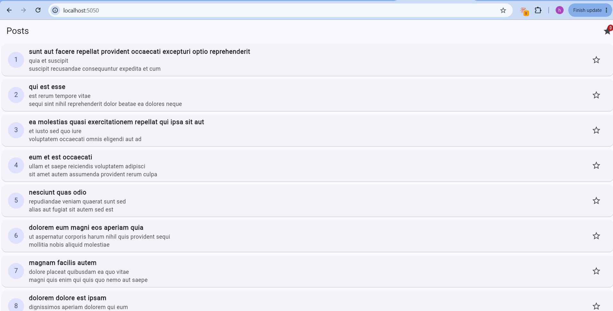
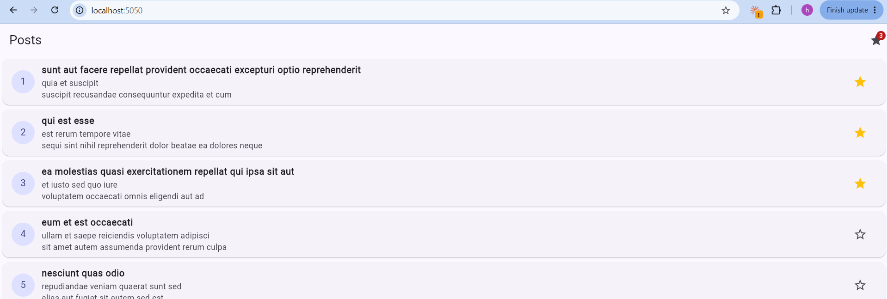
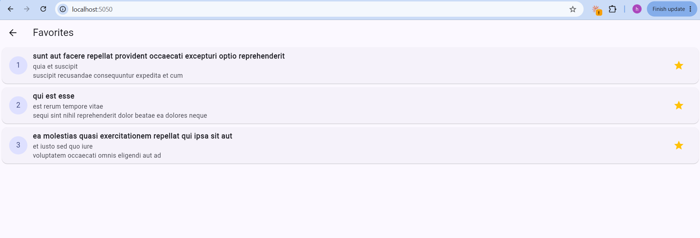
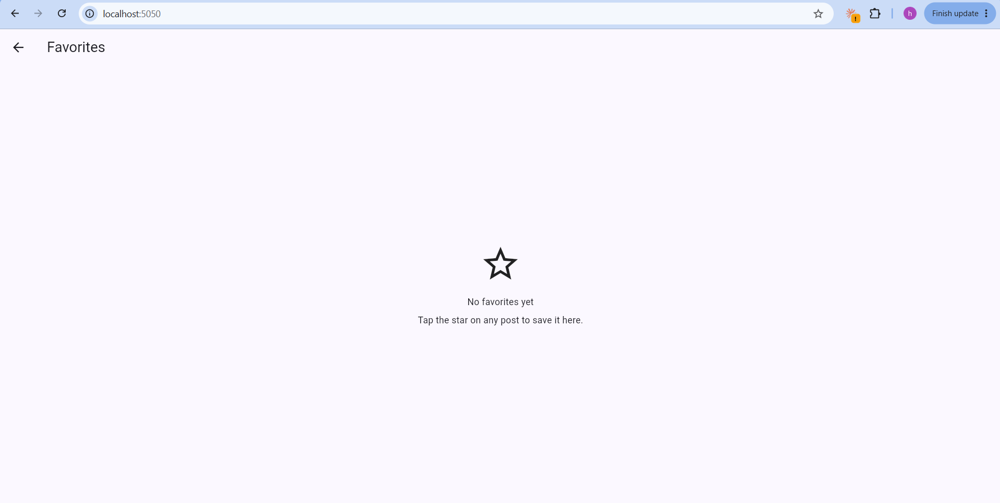
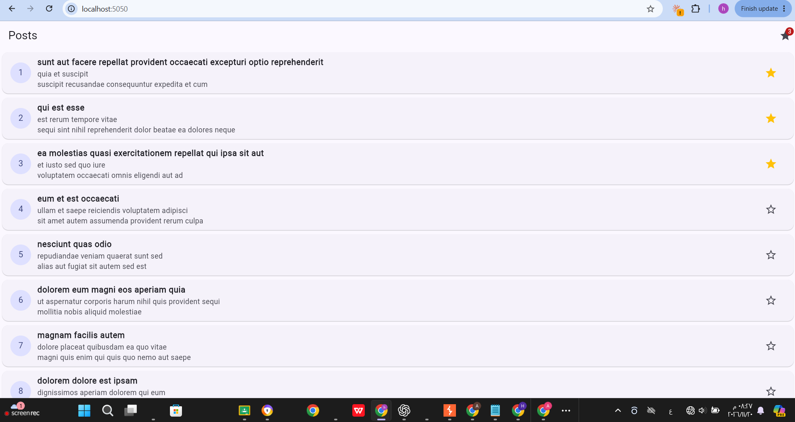
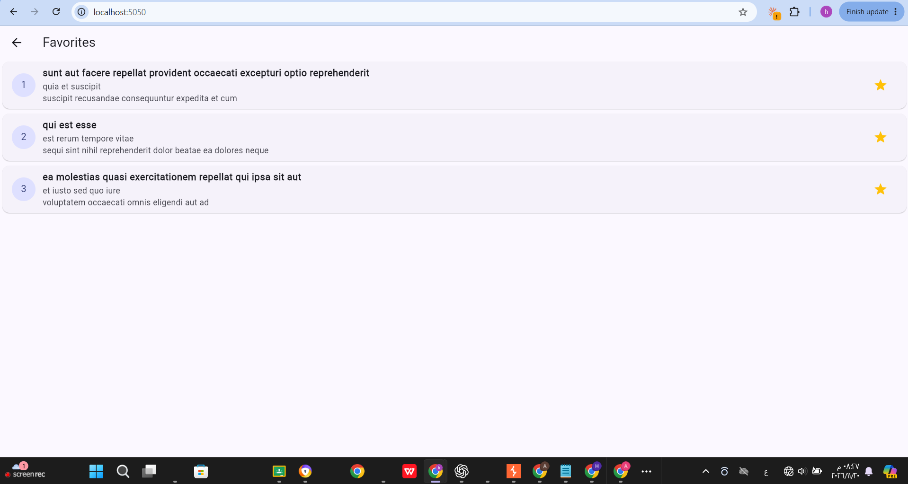

# Flutter Hive Offline Posts

A Flutter posts app that fetches JSONPlaceholder posts, caches them with Hive, and keeps favorites available offline.

## Features

- Fetch posts from the API and cache them locally.
- Read cached posts when the network is unavailable.
- Save and remove favorites with live star icons and a count badge.
- Keep favorites across refreshes and app restarts in a separate box.
- Pull to refresh and view loading, error, and empty states.

## Data flow

```text
INTERNET → API → Hive postsBox → ListView
                         star tap → favoritesBox → Favorites screen
```

## Project structure

```text
lib/
├── main.dart                     Initialize Hive and launch the app
├── models/
│   ├── post_model.dart           Hive model and JSON conversion
│   └── post_model.g.dart         Hive type adapter
├── services/
│   ├── post_service.dart        Fetch and cache posts; offline fallback
│   └── favorites_service.dart   Save, remove, and listen to favorites
├── widgets/
│   └── post_card.dart            Shared post card and star
└── screens/
    ├── posts_screen.dart         Posts, refresh, badge and navigation
    └── favorites_screen.dart     Live favorites list and empty state
test/
└── favorites_test.dart           Hive and widget checks
screenshots/                      Evidence captures
```

## SharedPreferences vs Hive

| | SharedPreferences | Hive |
|---|---|---|
| Best for | Small settings and primitive values | Local collections and structured objects |
| Data | Key-value primitives | Boxes with typed adapters and objects |
| Listening | Typically managed by app state | Box listenables update widgets |
| Offline | Local settings | Local records and cached data |

## How Favorites Work

Each post's ID is its key in `favoritesBox`. `put` adds a favorite, `containsKey` checks it, and `delete` removes it. A fresh `Post` copy is saved because a `HiveObject` can belong to only one box; the original is already stored in `postsBox`. The separate box also survives `postsBox.clear()` during refresh. `ValueListenableBuilder` listens to the favorites box so stars, the badge, and the favorites list update immediately.

## Getting Started

Install Flutter and Chrome. From the project directory:

```sh
flutter pub get
dart run build_runner build --delete-conflicting-outputs
flutter run
```

The adapter is included in the project; generation is useful when the model changes. If platform folders are absent, run `flutter create --platforms android,web,windows .` first.

## Screenshots

Tested on Chrome (web) because the Android SDK was not available on the development machine. Offline mode was tested by turning off Wi-Fi and reloading the app; posts and favorites were loaded from Hive (the taskbar shows no network connection).

| # | Feature / Action | Screenshot |
|---|---|---|
| 1 | Posts loaded from the API |  |
| 2 | Marking posts as favorites (filled stars + badge count) |  |
| 3 | Favorites screen |  |
| 4 | Empty state: "No favorites yet" |  |
| 5 | Offline: posts loaded from Hive after reload |  |
| 6 | Offline: favorites still saved after reload |  |

## Offline test steps

| Action | Expected result |
|---|---|
| Run online and load posts, then mark several favorites. | Posts appear, API cache message is logged, and stars fill. |
| Enable airplane mode and pull to refresh. | Cached posts appear and the offline Hive message is logged. |
| Restart while still offline and open Favorites. | Previously saved favorites remain visible. |
| Clear app data or reinstall, then start in airplane mode. | The no-internet and no-cached-data error appears. |

## Packages used

- `http`: API requests
- `hive` and `hive_flutter`: local storage and Flutter integration
- `connectivity_plus`: connectivity support
- `hive_generator` and `build_runner`: adapter generation
- `flutter_test`: unit and widget tests
